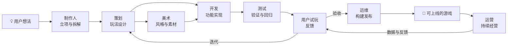

# Waypoint（航点）

> **游戏开发垂直领域的 Cursor。**
> 让普通用户通过简单的学习，用「对话」指挥一支完整的 AI 游戏开发团队，把创意做成**核心玩法闭环、可直接上线**的游戏。

## 一句话理解 Waypoint

- 对标 **Cursor**：Cursor 面向程序员、产出代码；Waypoint 面向普通人、产出**能玩的完整游戏作品**。
- 对 **用户**：不需要会编程、画画、策划，只需要会聊天——剩下的交给 Agent 团队。
- 对 **行业**：把「创意 → 玩法 → 实现 → 测试 → 发布 → 运营」整条游戏生产流水线 Agent 化。

## 产品形态

| 端 | 形态 | 定位 |
| --- | --- | --- |
| 手机 | 对话 APP | 随身指挥部：随时下达任务、审阅产出、试玩、做决策 |
| 桌面 | 对话 APP | 深度工作台：对话 + 实时预览 + 任务看板 + 资产库 |

两端同账号、同项目、同团队状态，随时随地无缝接力。

## 核心体验（我们如何定义「极致」）

1. **一个输入框，一支团队。** 用户用自然语言下达意图，制作人格自动澄清、拆解、分派、跟踪，用户只在关键节点做选择。
2. **所见即所玩。** 每一次生成都在可运行的预览里即时呈现，反馈以分钟计，而不是以天计。
3. **进度永远可见。** 任务看板、Agent 工作直播、产出物时间线，像看一支真正的团队在干活。
4. **上手 10 分钟。** 新手引导 + 模板库 + Agent 主动提问补全需求，普通用户第一次对话就能得到一个能玩的小游戏。

## Agent 团队

| 角色 | 职责概要 |
| --- | --- |
| 🎬 制作人 Producer | 需求澄清、任务拆解与排期、风险与验收，是用户的主要接口人 |
| 📐 策划 Designer | 核心玩法设计、数值、关卡、规则与文案 |
| 💻 开发 Engineer | 游戏逻辑实现、UI 搭建、功能自测与修复 |
| 🎨 美术 Artist | 美术风格、角色 / 场景 / UI 素材、音效音乐 |
| 🧪 测试 QA | 用例生成、自动化测试、Bug 定位与回归 |
| 🛠 运维 Ops | 构建、发布、环境、监控与容量 |
| 📣 运营 LiveOps | 上线后活动、数据分析、玩家反馈驱动迭代 |

详见 [docs/02-agents.md](docs/02-agents.md)。

## 核心工作流：从想法到上线

核心玩法闭环 = 用户能一直玩自己指挥开发出来的游戏，并且能把它发布给真实玩家。

## 技术架构（草案）

- **客户端层**：手机 / 桌面对话 APP
- **交互层**：对话编排、任务看板、实时预览、资产库
- **Agent 层**：多 Agent 编排、角色技能与工具、上下文与项目记忆
- **游戏运行时层**：Web-first，可打包多端发布
- **云平台层**：构建流水线、资产存储、发布渠道、数据回流

详见 [docs/03-architecture.md](docs/03-architecture.md)。

## 路线图

| 里程碑 | 目标 | 关键验收 |
| --- | --- | --- |
| M0 奠基 | 文档与原型验证 | 一次对话生成 1 个可玩的 HTML5 小游戏 demo |
| M1 MVP | 单 Agent 对话做出小游戏 | 普通用户 10 分钟内从 0 得到可玩的小游戏 |
| M2 团队 | 七角色多 Agent 协作 | 一个需求被自动拆成 ≥3 个角色的协作任务并交付 |
| M3 双端 | 手机 & 桌面 APP | 双端同一项目无缝接力 |
| M4 闭环 | 直接上线 | 用户作品全程在 Waypoint 内完成并公网可玩 |

详见 [docs/04-roadmap.md](docs/04-roadmap.md)。

## 文档导航

| 文档 | 内容 |
| --- | --- |
| [docs/01-product.md](docs/01-product.md) | 产品说明：目标用户、用户故事、核心场景、交互原则 |
| [docs/02-agents.md](docs/02-agents.md) | Agent 团队设计：职责、协作协议、交接物 |
| [docs/03-architecture.md](docs/03-architecture.md) | 技术架构草案 |
| [docs/04-roadmap.md](docs/04-roadmap.md) | 里程碑与验收标准 |

## License

待定（TBD）。
