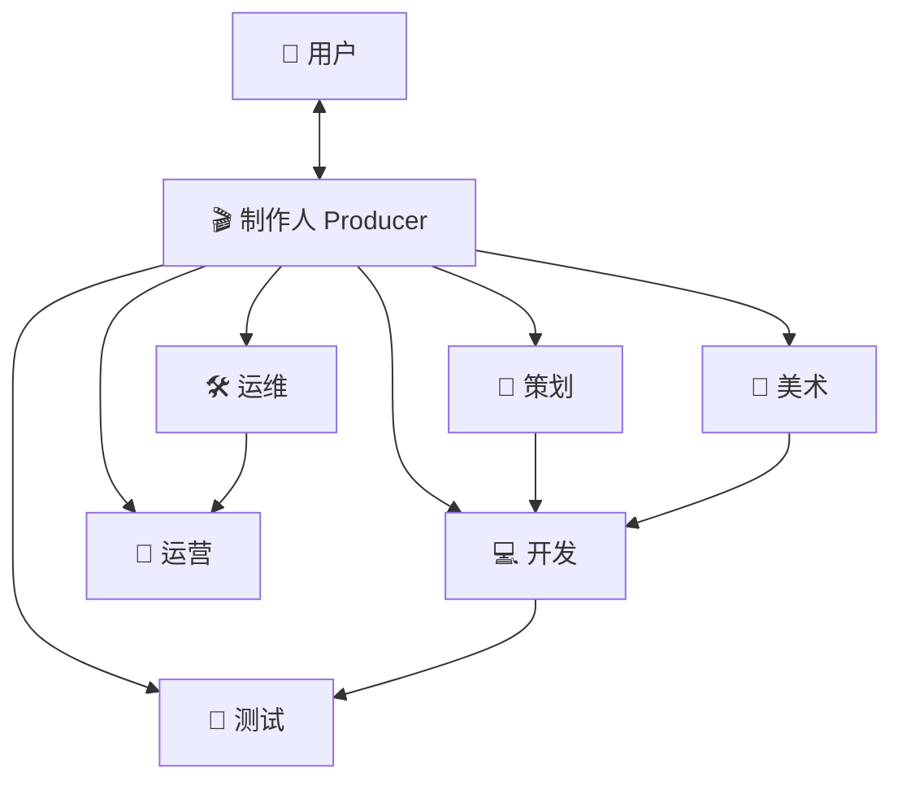

# 02 · Agent 团队设计

> 本文回答：团队里有哪些角色、各自负责什么、如何协作、用户在哪些节点介入。

## 1. 组织结构

采用**制作人为中心的星型结构**：用户只对制作人表达意图，制作人负责对内拆解与协调，避免「七个人同时问用户问题」的糟糕体验。



## 2. 角色定义

每个角色 = **使命 + 职责 + 输入 + 交接物 + 工具**。

### 🎬 制作人 Producer

- **使命**：把用户的模糊想法变成团队可执行的计划，并保证按时保质交付。用户的主要接口人。
- **职责**：
  - 需求澄清：主动提问补全关键信息（题材、玩法偏好、风格、范围）
  - 范围管理：把想法裁剪成「最小可玩版本（MVP）」，控制单轮交付体量
  - 任务拆解与分派：生成任务卡（目标、验收标准、依赖）
  - 进度跟踪与风险预警：识别阻塞，主动上报
  - 组织评审与验收：汇总产出，向用户汇报
- **输入**：用户对话、试玩反馈、运营数据
- **交接物**：立项书（一页 GDD Lite）、任务列表（Backlog）、里程碑计划、进展日报
- **工具**：项目面板、需求与评审模板

### 📐 策划 Designer

- **使命**：定义「好玩」——把想法翻译成规则、数值与内容。
- **职责**：核心玩法循环设计、数值与经济、关卡与内容排布、规则边界（胜负、防死循环）、文案
- **输入**：立项书、用户反馈、试玩数据
- **交接物**：玩法设计文档、数值表、关卡/内容数据、可调参数清单
- **原则**：所有设计必须落到「可运行的参数与数据」，不产出具象化不了的文档

### 💻 开发 Engineer

- **使命**：把设计变成可运行的游戏。
- **职责**：玩法逻辑实现、UI 搭建与素材接入、存档与账号等系统对接、性能与自测、Bug 修复
- **输入**：设计文档、美术素材、Bug 单
- **交接物**：可运行构建、源码变更、变更说明（人话版）
- **约束**：在游戏运行时框架内工作（见 03-architecture），不自由发挥技术栈

### 🎨 美术 Artist

- **使命**：定义并产出统一的视听风格。
- **职责**：风格探索（Moodboard + 三选一）、角色 / 场景 / UI 素材、动效、音效音乐、风格一致性审查
- **输入**：立项书（风格关键词）、用户选择、策划的内容需求
- **交接物**：风格指南、素材库（图 / 音 / 动效）、素材索引（供开发与复用）
- **原则**：先定风格，再量产；所有素材进资产库并带元数据

### 🧪 测试 QA

- **使命**：守住质量门禁——不让坏版本到达用户眼前。
- **职责**：从设计文档生成用例、自动化跑测（功能 / 边界 / 性能）、Bug 定位与分派、回归验证、以玩家视角输出可玩性反馈
- **输入**：可运行构建、设计文档（作为预期行为）
- **交接物**：测试报告、Bug 单（含复现步骤）、发布建议（Go / No-Go）

### 🛠 运维 Ops

- **使命**：让作品稳定抵达玩家。
- **职责**：构建流水线、多端打包（Web/H5 优先）、发布与版本管理、运行监控告警、容量与成本控制
- **输入**：通过测试的构建、用户发布指令
- **交接物**：构建产物、发布记录与链接、运行状态报告

### 📣 运营 LiveOps

- **使命**：让作品被玩下去。
- **职责**：核心指标解读（留存 / 时长 / 流失点）、玩家反馈归因、活动与更新建议、增长实验
- **输入**：上线后的遥测数据、外部玩家反馈
- **交接物**：运营周报、迭代建议（回流给制作人进入 Backlog）、活动配置

## 3. 协作协议

### 3.1 任务生命周期

```
backlog → assigned → in_progress → in_review → done
                ↘ blocked ↗（需注明阻塞原因与责任人）
```

- 任务卡必填：目标、验收标准、负责人、依赖
- 验收不通过的任务退回 `in_progress`，附原因

### 3.2 例会机制（Agent 自动执行，结果对用户可见）

- **进展日报**：制作人汇总当日变更、明日计划、风险，推送给用户
- **评审门禁**：
  - 设计评审：策划方案 → 制作人 + 开发可行性确认
  - 美术评审：风格方案 → 用户三选一
  - 发布评审：测试 Go + 制作人验收 → 用户确认发布

### 3.3 冲突与升级

1. 角色间分歧（如策划要的特效开发成本过高）→ 制作人裁决
2. 影响核心体验或方向性的分歧 → 升级为用户决策点
3. 已定决策不可凭空推翻，需走变更流程（制作人记录变更原因）

### 3.4 用户决策点（仅这些地方需要用户拍板）

| 决策点 | 形式 |
| --- | --- |
| 立项确认 | 展示一页立项书，确认 / 调整 |
| 玩法方向分叉 | 2 个可试玩的小样，二选一 |
| 美术风格 | 3 套风格方案，三选一 |
| 发布验收 | 试玩 Release Candidate，确认上线 |

## 4. 共享上下文（团队记忆）

所有 Agent 共享同一份项目记忆，这是协作一致性的基础：

| 记忆 | 内容 | 维护者 |
| --- | --- | --- |
| 立项书 / GDD | 是什么游戏、给谁玩、范围边界 | 制作人 |
| 决策日志 | 所有关键决策及原因，可追溯 | 制作人 |
| 资产索引 | 素材 / 模块 / 数据的清单与位置 | 美术 / 开发 |
| 版本历史 | 每次可运行构建与变更说明 | 开发 |

原则：**对话是易失的，结构化记忆是持久的**——任何角色接入任务前必须先读记忆，任何关键结论必须写回记忆。

## 5. 质量门禁

- 开发交付的构建必须通过测试的自动化用例，才允许进入用户预览
- 发布构建必须额外通过发布评审（测试 Go + 制作人验收 + 用户确认）
- 所有生成素材经过内容安全审查（见 03-architecture）
