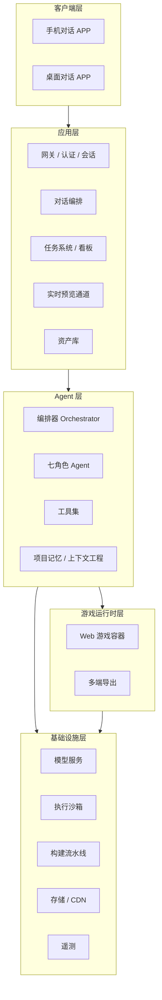

# 03 · 技术架构（草案）

> 本文回答：系统分几层、关键技术如何选型、难点在哪里。标注「⏳ 待定」的项在对应里程碑前完成决策。

## 1. 总体分层

## 2. 各层设计

### 2.1 客户端层

| 端 | 建议选型 | 备注 |
| --- | --- | --- |
| 桌面 | **Tauri**（⏳ 备选 Electron） | 体积小、内存占用低；如重度依赖 Node 生态则 Electron |
| 手机 | **Flutter**（⏳ 备选 React Native） | 双端一致、UI 还原度高；M3 前定稿 |

客户端核心组件：对话流（流式渲染）、任务看板、游戏预览容器（WebView / 内嵌运行时）、资产浏览器、版本回滚入口。

### 2.2 应用层

- **实时通道**：WebSocket（双向：任务状态、Agent 直播流）+ SSE（模型流式输出）
- **任务系统**：任务状态机（见 02-agents §3.1），事件驱动，所有变更落库并广播给客户端
- **预览通道**：Agent 产出构建 → 存储签名 → 客户端拉取并在沙箱化 WebView 中运行；支持热更新与版本切换
- **资产库**：素材 / 音频 / 数据统一存储，带元数据与版本

### 2.3 Agent 层（项目的技术核心）

- **编排器**：以制作人为中心调度（星型结构，见 02-agents）；负责任务分派、依赖排序、超时与重试、并发控制
- **角色定义**：每个 Agent = 系统提示词（使命 / 职责 / 输出契约）+ 技能库 + 工具白名单；角色间通信通过结构化任务卡与交接物，不通过自由聊天
- **工具集**：
  - 开发：代码生成与修改、沙箱执行、运行时 API
  - 美术：图像生成 / 风格化、音频生成、切图与压缩
  - 策划：数值模拟、关卡数据编辑
  - 测试：自动化跑测、截图对比、日志分析
  - 运维：构建触发、发布 API、监控查询
- **上下文工程**（最大的难点与壁垒）：
  - 分层记忆：项目记忆（GDD / 决策日志 / 资产索引，结构化持久）＞ 会话记忆（当前对话）＞ 工作记忆（当前任务相关切片）
  - 检索：资产与代码变更按任务相关性检索，避免全量上下文
  - 预算：按角色分配 Token 预算，制作人负责汇总与裁剪
- **框架选型**：⏳ 自研轻量编排起步（可控、可调试），预留接入开源 Agent 框架的接口

### 2.4 游戏运行时层

**Web-first 是最重要的架构决策**：普通用户产出的游戏以 Web（HTML5 / Canvas / WebGL）为第一公民。

- 理由：预览即成品（所见即所玩的前提）、发布零门槛（链接即上线）、跨端一致
- 游戏框架：⏳ 基于 Phaser / PixiJS 封装「玩法模版框架」（M1 定稿），对 Agent 暴露稳定的游戏 API（实体、场景、数值、存档），约束开发格局在框架内工作
- 导出矩阵：Web/H5（M4）→ 原生壳 Capacitor（M4+）→ 小程序 / 桌面（远期）

### 2.5 基础设施层

- **模型服务**：多模型路由（角色 × 任务类型 → 最优模型），统一网关计 Token；⏳ 供应商待定
- **执行沙箱**：Agent 生成的代码在隔离容器 / Worker 中执行，防逃逸；资源与时长限额
- **构建流水线**：构建 → 自动化测试 → 签名 → 发布候选；全链路可回滚
- **遥测**：游戏侧埋点（玩法漏斗、流失点）回流给运营格与用户看板

## 3. 关键难点与对策

| 难点 | 对策 |
| --- | --- |
| 生成代码质量不稳定 | 约束在玩法框架内生成 + 自动化测试门禁 + 可回滚版本 |
| 多 Agent 上下文爆炸 | 分层记忆 + 按任务检索 + 角色级 Token 预算 |
| 长任务失败率高 | 任务原子化、断点续跑、幂等重试、失败降级为人话提示 |
| 美术风格漂移 | 风格指南作为强约束注入每次生成 + 一致性审查 |
| 成本不可控 | 模型路由分级、预算护栏、用户可见的额度体系 |

## 4. 安全与合规

- **内容安全**：生成素材与文案接入审核（色情 / 暴力 / 版权风险）；面向低龄用户的内容分级
- **沙箱隔离**：用户游戏与平台隔离，防恶意代码；Agent 工具调用最小权限
- **数据隐私**：对话与项目数据加密存储，明确归属用户
- **版权**：生成资产的商用授权链路清晰，训练数据合规

## 5. 技术决策记录（ADR）

重大选型以 ADR 形式记录在 `docs/adr/` 下（待建立）：背景 → 选项 → 决策 → 后果。首个 ADR：游戏运行时框架选型（M1 前）。
